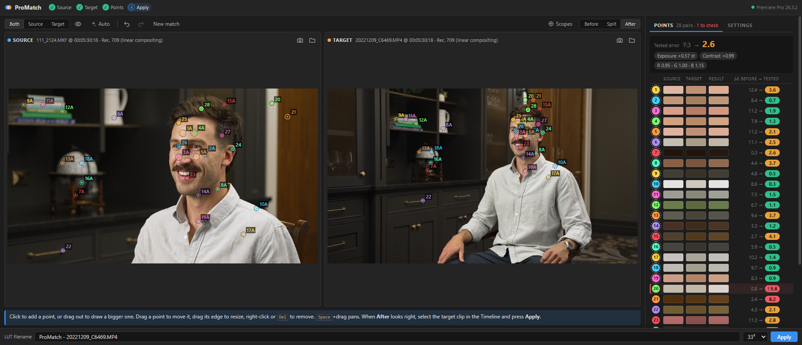
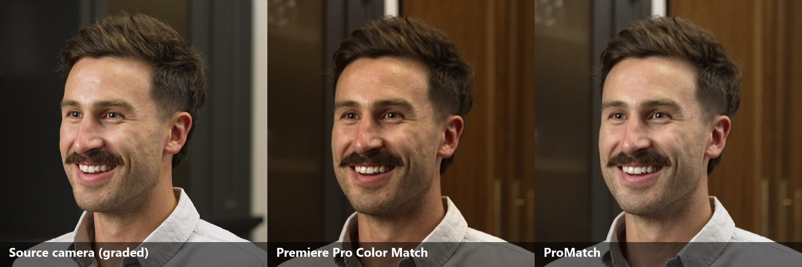
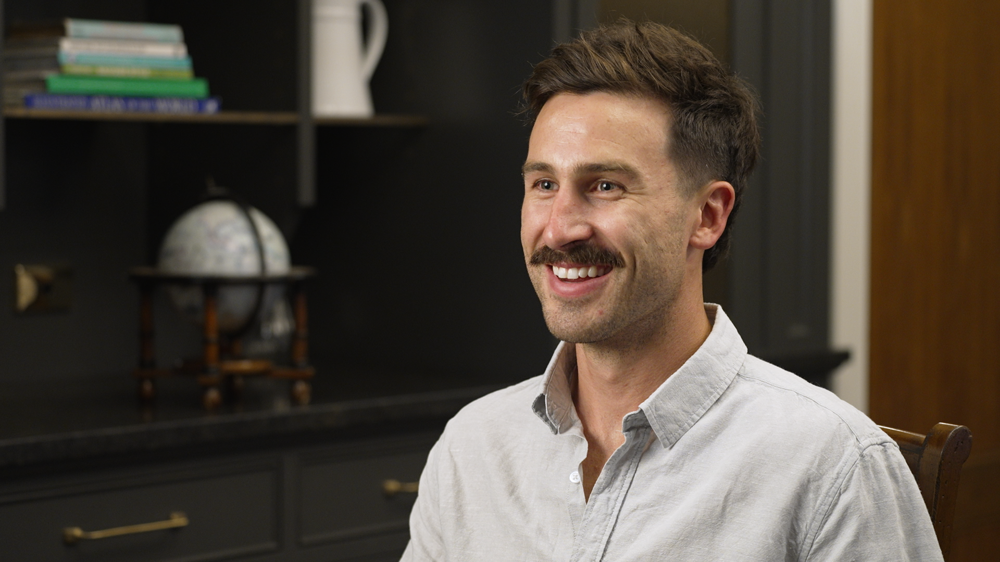
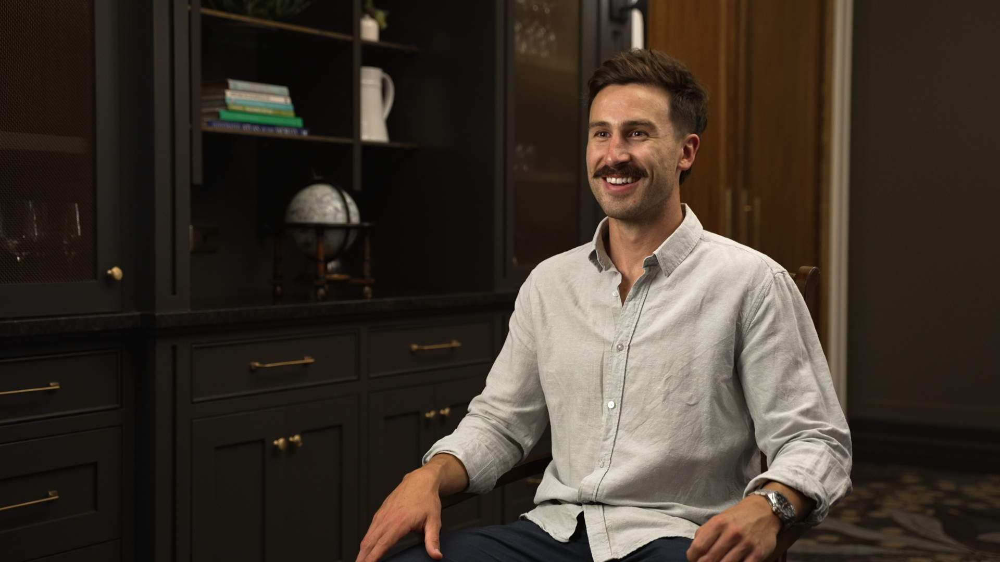
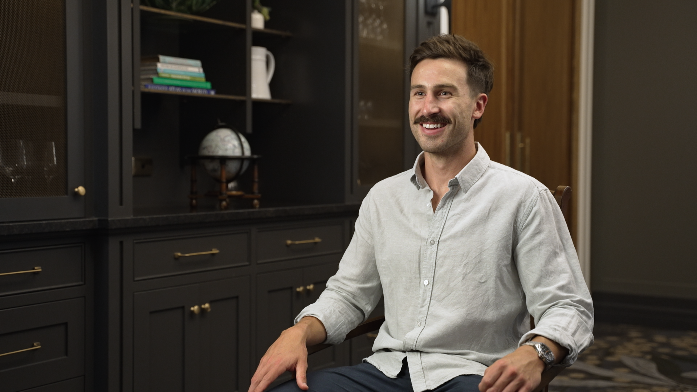

# ProMatch

A free Premiere Pro panel that matches the colour of one camera angle to another, made for
multicam interviews. Press **Auto** for a starting set of points it finds itself, faces included,
then keep clicking to add your own, picking the same thing in both shots. ProMatch works out how
to turn the target camera's colours into the source camera's. It shows the result live, then puts
it on the clip in one click with its own **ProMatch** effect, and saves it as a `.cube` LUT too.

## Compared with Premiere Pro's Color Match

The wide camera from the shot above, matched to the graded close-up. Color Match leaves the skin
darker and more orange and the shirt yellow; ProMatch's lands much closer to the source.

Full frames

| Source camera (graded) | Premiere Pro Color Match | ProMatch |
| --- | --- | --- |
|  |  |  |

## Install

From the [latest release](https://github.com/thinkvp/ProMatch/releases/latest), close Premiere,
and run the installer:

- **Windows:** `ProMatch-<version>-win-setup.exe`
- **macOS:** `ProMatch-<version>-mac.pkg`. It isn't registered with Apple, so macOS asks you to
  allow it the first time ([how](docs/INSTALL.md#macos)).

Then open **Window ▸ Extensions ▸ ProMatch**. Details: [docs/INSTALL.md](docs/INSTALL.md).

Needs Premiere Pro 2021 (15.0) or later, on Windows 10 or 11, or macOS 11 or later (Apple
Silicon or Intel). The panel checks for new versions once a day and shows a banner when one is
out.

## Quick start

1. **Source.** Put the playhead on the camera you want to match *to* and press **Capture**.
2. **Target.** Switch to the camera you want to fix, at the same moment if you can, and press
   **Capture**.
3. **Points.** Press **Auto** for a starting set of pairs, including some on faces. Delete any
   that look wrong, then add your own: click something on the source, then the same thing on the
   target. Plain areas like walls and sofas need picking by hand.
4. **Check.** Compare with **Before / Split / After**, and open **Scopes** (**S**) to compare the
   source with the matched target.
5. **Apply.** Select the target camera's clips in the Timeline and press **Apply**. Press it
   again after more tuning and every clip using the match updates.

For multicam, apply it to the angle's clip inside the multicam source sequence, so every cut to
that camera inherits it.

The match is stored inside the effect, so the project opens matched on any computer with
ProMatch installed. **Edit LUT** in Effect Controls reopens the panel on the frames and points
that made it.

## More

- [docs/GUIDE.md](docs/GUIDE.md): the full guide (points, the tested error, scopes, settings, the
  effect).
- [docs/HOW-IT-WORKS.md](docs/HOW-IT-WORKS.md): how the match, Auto and the LUT are computed,
  and how the defaults were tested.
- [docs/DEVELOPMENT.md](docs/DEVELOPMENT.md): building from source ([docs/MAC.md](docs/MAC.md) for
  the Mac build);
  [docs/RELEASING.md](docs/RELEASING.md): cutting a release.
- [CHANGELOG.md](CHANGELOG.md)

## Roadmap

- **UXP.** Move the panel from CEP to Adobe's UXP, which is replacing CEP in Premiere.

## Licence

[MIT](LICENSE). Bundled components keep their own licences:
[THIRD-PARTY-NOTICES.md](THIRD-PARTY-NOTICES.md).
